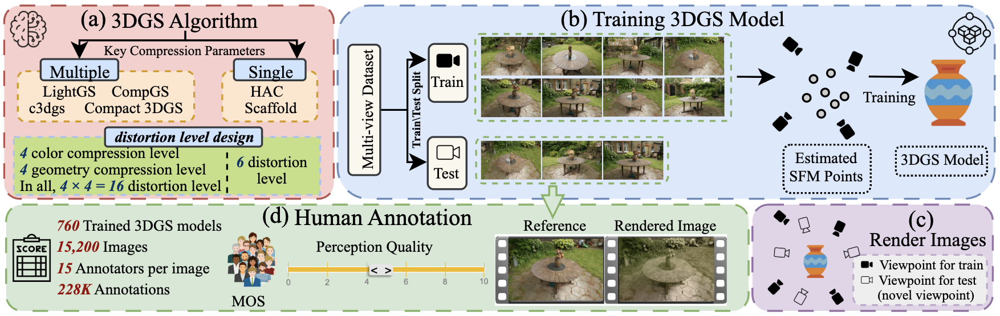
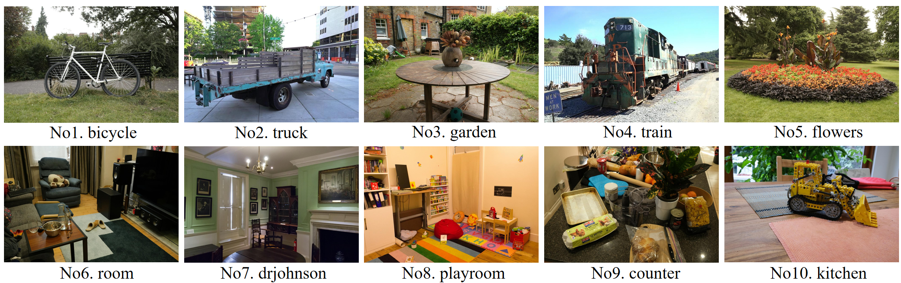
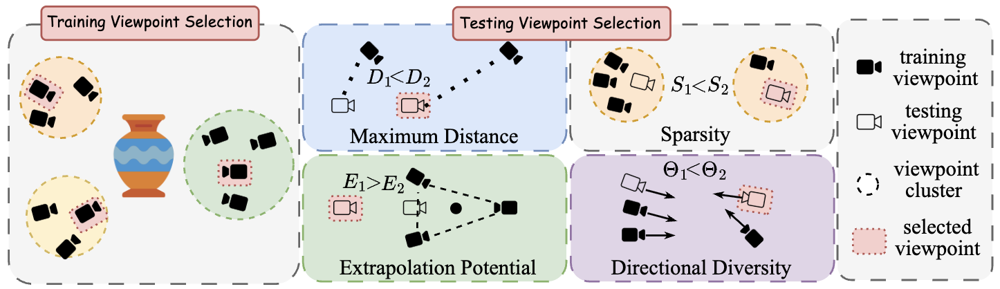

<h1 align="center">3DGS-IEval-15K: A Large-scale Image Quality Evaluation Database for 3D Gaussian-Splatting </h1>

<p align="center">
  <a href="https://arxiv.org/abs/2504.08358"></a>
  <a href="https://arxiv.org/abs/2608.03279"></a>
  <a href="https://huggingface.co/datasets/Chole12/3DGS-IEval-15K/tree/main"></a>
</p>

<p align="center">
  
</p>

---

## 📌 Overview

3DGS-IEval-15K is the first large-scale image quality assessment (IQA) dataset specifically designed for compressed 3DGS representations. It includes:
- **6** representative 3DGS algorithms
- **10** real-world scenes
- **760** Trained 3DGS models
- **20** strategically selected viewpoints
- **15,200** images
- **15** Annotators per image
- **228K** Annotations

---

## 📌 Source Content
<p align="center">
  
</p>

**3 Source 3DGS multi-view image dataset:**

- **DeepBlending**：https://github.com/Phog/DeepBlending?tab=readme-ov-file （playroom, drjohnson）

- **Mipnerf360**：https://jonbarron.info/mipnerf360/ （bicycle, flowers, garden, kitchen, room, counter）

- **TanksandTemples**:  https://www.tanksandtemples.org/download/ （train, truck）

---

## 📌 Training and Testing Viewpoints Selection
<p align="center">
  
</p>

The dataset can be downloaded at the following link: https://huggingface.co/datasets/Chole12/3DGS-IEval-15K

---

## 📌 Citation

If you use this dataset, please cite the following papers:

(1) Xing Y, Wang J, Niu P, et al. 3dgs-ieval-15k: A large-scale image quality evaluation database for 3d gaussian-splatting[C]//Proceedings of the 33rd ACM International Conference on Multimedia. 2025: 12682-12689.

(2) Xing Y, Wang J, Gordon W, et al. 3DGSI-Assessor: A Large-Scale Dataset and An LMM-based Method for 3D Gaussian Splatting Image Quality Assessment[J]. arXiv preprint arXiv:2608.03279, 2026.

```bibtex
@inproceedings{xing20253dgs,
  title={3dgs-ieval-15k: A large-scale image quality evaluation database for 3d gaussian-splatting},
  author={Xing, Yuke and Wang, Jiarui and Niu, Peizhi and Huang, Wenjie and Zhai, Guangtao and Xu, Yiling},
  booktitle={Proceedings of the 33rd ACM International Conference on Multimedia},
  pages={12682--12689},
  year={2025}
}

@article{xing20263dgsi,
  title={3DGSI-Assessor: A Large-Scale Dataset and An LMM-based Method for 3D Gaussian Splatting Image Quality Assessment},
  author={Xing, Yuke and Wang, Jiarui and Gordon, William and Li, Zhu and Zhai, Guangtao and Xu, Yiling},
  journal={arXiv preprint arXiv:2608.03279},
  year={2026}
}
```
